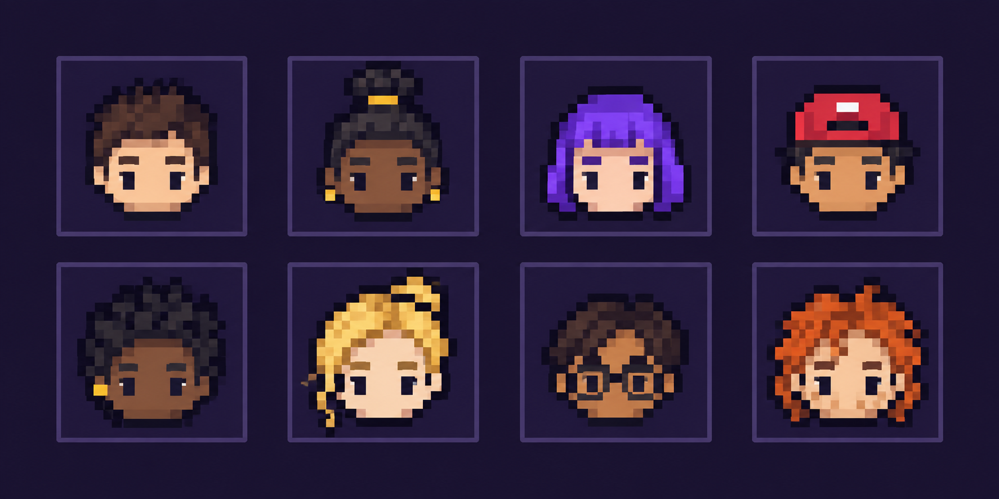

# FlipTheMeme / MemePred — задание на разработку MVP

**Версия:** 11 сентября 2026. **Назначение:** передача разработчику или coding-агенту.
**Статус:** единая продуктовая спецификация для начала реализации. Код приложения и программы ещё не создан. Технические вопросы первого этапа перечислены отдельно; они не выдаются за решённые.

Этот файл — основной вход в разработку. Он заменяет карту, колоду, индивидуальные матчи и полнофигурные аватары из предыдущих обсуждений. При противоречиях с архивными файлами использовать этот документ и последующие прямые указания Софии.

## 1. Что строим

Android-приложение для Solana dApp Store и подачи на CLOCK IN до **8 октября 2026**.

**Продукт:** общая арена коротких UP/DOWN-прогнозов на свежие Solana-токены. Все участники одного раунда видят один токен, имеют общие моменты начала и окончания измерения цены и видят других игроков по пиксельному лицу и .skr-имени.

**Формулировка для пользователя:** «Свежий мемкоин. Общий старт. 60 секунд, чтобы проверить свой прогноз против других Seeker-игроков — без покупки самого токена».

Подача принята как направление работы. Уточнение условий у организаторов не является зависимостью разработки. Паузы на Арбитрум нет. Разработку не останавливать для повторного обсуждения уже выбранной формы продукта.

## 2. Решения, от которых отталкиваемся

| Область | Решение |
|---|---|
| Основной экран | Одна общая арена, центральный график, две группы UP/DOWN |
| Денежная механика | Тотализатор: общий банк и пропорциональная выплата победителям |
| Валюта ставки | SOL; суммы программы в lamports |
| Длительность | 60 секунд измеряемого движения, полный цикл с набором дольше |
| Контрагент | Другие участники; дом и внешний LP-пул в MVP отсутствуют |
| Позиции | Одна оплаченная позиция на authority в каждом раунде; без докупки, смены стороны и отмены принятой ставки |
| Комиссия | Рабочая настройка: 1% чистого выигрыша, то есть 1% проигравшего банка; потолок 1% |
| Кошелёк | MWA для подключения, средств и разрешений; ограниченная сессия для игры |
| Аватары | Только настраиваемые пиксельные лица/головы в направлении Pixels и MattleFun |
| Возврат в игру | Общие короткие сессии, бесплатный прогноз, история, узнаваемые участники |
| SKR | Косметика в той же арене после готовности ядра; отдельной комнаты и стейкинга нет |

Тотализатор и база комиссии выбраны как рабочие решения по поручению пользователя выбрать механику. Это не результаты A/B-теста и не утверждение о доказанном удержании.

## 3. Объём первой версии

**Обязательное ядро:**

- Работающий Android APK и MWA на физическом Android.
- Одна арена, один поддерживаемый источник пулов, одна длительность движения.
- Общий раунд, реальные транзакции в devnet, вход/закрытие/расчёт/выплата/возврат.
- Доступный баланс, заблокированная сумма, история и детали расчёта.
- Ограниченная сессия, защита от повтора действий, восстановление после офлайна.
- Пиксельные лица с простым редактором.

**После полного денежного сценария, до подачи:**

- .skr-имена, SGT-проверка, один бесплатный прогноз в день для подтверждённого SGT.
- Приглашение через системный Share, карточка результата.
- Расписание общих сессий; без обещания постоянно заполненной арены.

**Только если ядро готово:** одна SKR-косметика, push о сессии, простой недельный рейтинг точности.

**Не реализовывать:** карту, колоду, рилсы, ходьбу, тела/одежду/полнофигурных персонажей, 3D, подбор пар 1:1, Order/Match, пятиминутную очередь, дом, внешние LP-депозиты, отдельную SKR-комнату, автоставку выигрышем, cashout посреди раунда, 16 бейджей, свободный чат, iOS, собственный токен/NFT аватара.

## 4. Пользовательский сценарий

1. Приложение сразу показывает текущую арену, её фазу и график. Для просмотра кошелёк не нужен.
2. Если открыт набор, можно выбрать бесплатный прогноз либо денежную позицию. Если набор закрыт — смотреть и дождаться следующего раунда.
3. Для денежной позиции подключить кошелёк, пополнить игровой баланс и выдать ограниченное разрешение на сессию через MWA. Эти действия не повторяются на каждой ставке внутри разрешения.
4. Выбрать сумму и UP/DOWN. До отправки видны риск, комиссия и предварительная выплата с учётом собственной ставки.
5. До подтверждения транзакции позиция отображается как ожидающая. После подтверждения лицо появляется в соответствующей группе, сумма блокируется.
6. Закрытие набора фиксирует банки и потенциальные выплаты. Начальная цена определяется после закрытия приёма, по заранее опубликованному правилу.
7. По окончании движения показывается результат, затем подтверждение расчёта и зачисление/возврат. Окончание таймера не равно подтверждённой выплате.
8. Выигрыш остаётся доступным на балансе. Следующая ставка — только новым действием пользователя.

Вход в редактор лица не должен задерживать первый просмотр/прогноз: стартовый образ уже есть, настройку можно пропустить.

## 5. Экраны и состояния

### Арена

- Токен, возраст, источник/пул; 2–3 доступных сигнала для решения, выбранных после проверки данных.
- График — главный элемент. До старта показать историю и её период, во время раунда — изменение от общего P0 и стартовую линию.
- Один подписанный таймер: «Вход закроется», «До результата» или статус «Подтверждаем расчёт».
- Две группы с банками и предварительными/окончательными выплатами. Долю денег не подписывать как вероятность события.
- Компактные строки участников: **пиксельное лицо + .skr-имя/сокращённый адрес + сумма**. Зрители и бесплатные прогнозы не изображаются денежными позициями.
- Своя позиция, свободный баланс и сумма под риском; равноценные UP/DOWN до входа.
- При закрытом наборе — просмотр и следующий раунд; при отсутствии допустимого токена — честное ожидание. Не изображать запись или ботов живыми людьми.
- Обязательные отдельные состояния: загрузка, offline/stale data, отправка, подтверждение, отказ транзакции, истёкшая сессия, закрытый набор, pending settlement, settled, refunded.

### Баланс и история

Доступно / заблокировано, пополнение, вывод свободных средств, условия активной сессии и отзыв. История содержит все исходы, а не только выигрыши. Детали позиции: токен, времена, сторона, ставка, P0/P1, правило цены, комиссия, начисление, причина возврата и ссылка на транзакцию. Прямой путь claim/refund доступен при сбое автоматического обслуживания.

### Профиль и редактор лица

Проверенное имя, собственное лицо, редактор, настройки уведомлений/звука/вибрации. Не создаём отдельный игровой мир или гардероб тела.

## 6. Тотализатор: точная математика

Для выигравшей стороны с банком W и проигравшей с банком L, ставки победителя s:

```text
fee    = floor(L * fee_bps / 10_000)
prize  = L - fee
payout = s + floor(prize * s / W)
```

Рабочее значение `fee_bps = 100`, максимум 100. В программе — целочисленные lamports и checked arithmetic с широким промежуточным произведением. Комиссия — один раз на весь раунд, не повторно с каждого claim. Выигравшая ставка возвращает тело s; проигравшая получает 0.

Пример окончательных банков UP = 0,6 SOL, DOWN = 0,2 SOL. Ставка 0,01 SOL уже включена в банк своей стороны:

| Исход | Комиссия раунда | Выплата владельцу указанной выигравшей ставки |
|---|---:|---:|
| UP | 0,002 SOL | 0,0133 SOL |
| DOWN | 0,006 SOL | 0,0397 SOL |

Это выплата вместе с телом, а не чистая прибыль. В preview ещё не отправленной позиции сначала добавить её сумму в выбранную сторону. До cutoff сумма меняется при новых ставках; после cutoff фиксируется.

Комиссия с прибыли — ниже по выручке, чем 1% общего банка: при равных сторонах это 0,5% банка. Не считать расходы и спонсирование исходя из старой базы комиссии.

Округление: каждая выигравшая позиция получает округлённую вниз долю прибыли. Остаток учитывается в Round; после обработки всех выигравших позиций остаток меньше их числа lamports может переводиться в fee treasury отдельной проверяемой инструкцией. Нельзя забирать остаток раньше и нельзя считать невостребованные выплаты округлением. Автоматического сгорания права пользователя на claim в MVP нет.

При отсутствии одной стороны, возвратном исходе, невалидных данных или разрешённом timeout: вернуть ровно принятую ставку, протокольная комиссия 0. Сетевые расходы отдельно и не обещаются возвращёнными.

## 7. Жизненный цикл и время

```text
SCHEDULED → OPEN → LOCKED → ACTIVE → SETTLED_UP / SETTLED_DOWN
                        ↘ REFUNDABLE ← сбой цены / ничья / timeout
```

- Приём ограничивается часами программы, даже если keeper ещё не вызвал закрытие. На границе и позже новая ставка отклоняется.
- Момент подписи/клиентского тапа не даёт права входа. Состояние сети после исполнения транзакции — источник истины.
- После cutoff банки неизменны. При пустой стороне можно перевести раунд в возврат без запроса цены.
- Общее начальное окно цены целиком расположено после cutoff. Конечное окно измеряет результат через 60 секунд относительно выбранной опорной точки начального окна.
- Время набора, запас между cutoff и наблюдениями, длительности окон, точность, зона равенства и deadline фиксируются до набора и не меняются для открытого раунда.
- Валидное резкое падение — обычный DOWN-исход. Не возвращать деньги только потому, что токен обвалился.
- До deadline расчёт возможен лишь с валидными предусмотренными наблюдениями. После deadline нерассчитанный раунд переводится в возврат; поздний keeper не может отменить уже установленный возврат.
- Исход финализируется один раз. Повторные settlement/claim/refund не создают повторные начисления.

Приведённая схема — требования к поведению; точные enum/инструкции выбрать при реализации. Терминальные переходы и гонки settlement/refund проверять в программе.

## 8. Источник цены: обязательный первый этап

**Источник ещё не выбран.** Не обещать pump.fun до проверки нужной стадии токена: bonding curve, миграция и CLMM/DLMM не являются взаимозаменяемыми источниками. Наличие oracle-аккаунта само по себе недостаточно.

Первое инженерное задание:

1. Выбрать один тип источника/пула; проверить его программу, формат данных, котировку и необходимые наблюдения на реальных молодых пулах.
2. Определить воспроизводимое правило P0/P1: точные интервалы, метод усреднения, единицы, округление, минимальное покрытие окна и допустимую давность.
3. Проверить редкие сделки, отсутствие наблюдений, миграцию и остановку пула. Зафиксировать, когда раунд не открывается, а когда возвращается.
4. Установить фильтры допуска и лимит общего банка с учётом глубины рынка. Отдельный per-wallet cap не заменяет общий лимит.
5. Записать результат в `docs/implementation/price-source.md`, приложить воспроизводимую проверку и примеры данных. Затем включить этот адаптер в рабочий раунд.

Можно параллельно делать UI на явно помеченном mock-источнике и денежную программу на devnet с тестовыми значениями. Mock не выдаётся за живой рынок.

Если MVP использует цену, подписанную нашим сервером, это явно указанная граница доверия: onchain-расчёт денег не делает поставщика цены независимым. Программа проверяет authority, Round/pool, времена, формат и возможность перехода; сервер сохраняет исходные наблюдения для воспроизведения. Произвольная цена из клиентского запроса не принимается.

## 9. Архитектура

Предлагаемый стек: React Native/Expo для Android, Anchor/Rust для программы, TypeScript для API/keeper и общего клиента. Конкретные совместимые версии закрепить после первого рабочего APK и теста MWA. Наличие готового кода watcher в других проектах пока не проверено; не считать его перенос бесплатным или выполненным.

**Состояние программы:**

- Config/Market: разрешённые источники, администратор конфигурации, пауза новых входов, параметры для будущих раундов.
- Vault: доступные деньги authority и учёт блокировок.
- Session: signer, authority, expiry, max_per_bet, gross session_cap и накопленный расход.
- Round: источник, все времена и ценовое правило, комиссия/лимиты snapshot, банки, результат, цена, обязательства и остатки.
- Position: уникальная пара Round + authority, сторона, сумма, признак обработки.

**Основные действия:** открыть/пополнить хранилище; вывести свободные средства; начать/отозвать сессию; создать раунд; поставить; зафиксировать валидные наблюдения и исход; установить возврат по правилам; начислить выплату/возврат ровно один раз. Названия инструкций не обязательны, поведение обязательно.

**API/keeper:** подбор допустимого токена, расписание раундов, доставка графика, индекс подтверждённых состояний, обслуживание settlement/claim, профили и приглашения. Клиент восстанавливает authoritative snapshot после переподключения; websocket-событие не является единственным доказательством позиции.

API/профиль не имеет полномочий изменять денежный результат. Onchain authority цены и upgrade authority программы явно описываются в документации сборки.

## 10. Разрешения и инварианты

- MWA подтверждает подключение/подпись входа, денежные операции и выдачу/отзыв разрешений. Сессионный ключ не выводит деньги, не повышает лимит и не продлевает себе срок.
- Лимиты проверяет программа. Библиотека session keys не подменяет финансовые ограничения.
- Расход сессии считается по сумме принятых денежных ставок. Выигрыш и возврат не обнуляют счётчик; новое разрешение выдаёт пользователь.
- Одна позиция на authority/round; retries и повторный тап не дублируют debit.
- Заблокированные деньги недоступны выводу. Пауза новых входов не должна блокировать предусмотренные выплаты/возвраты.
- Все обязательства обеспечены; деньги пользователей, комиссии, rent и деньги на оплату транзакций учтены раздельно. Не сравнивать сумму пользовательских балансов с lamports произвольного одного аккаунта без учёта структуры хранения.
- Изменение конфигурации действует только на будущие раунды. Уже открытый раунд сохраняет параметры.
- Claim/refund может обслужить keeper или иной допустимый вызывающий, но получатель фиксирован исходной authority/Vault, а не выбран вызывающим.

## 11. Пиксельные лица: обязательное направление



Изображение — сохранённое направление внешности, не готовый атлас и не доказательство работоспособности всех комбинаций. Оно создано встроенным ImageGen; точный prompt и назначение записаны в [описании референса](docs/design-references/pixel-faces-concept.md).

- Ориентиры: Pixels / MattleFun. Sims относится только к возможности настраивать внешность.
- Только лицо/голова с волосами. Ни тел, ни плеч, ни фигур в полный рост даже в редакторе.
- Настройки: кожа, причёска, цвет волос, простые черты лица и аксессуары.
- Стартовый объём: до 6 тонов кожи, 8 причёсок, 6 цветов волос; при нехватке времени сокращать разнообразие, сохраняя возможность выбора.
- Пробная сетка 24×24 или 32×32, после проверки читаемости выбрать одну. Общие палитры, точки совмещения и масштабирование без сглаживания.
- Слои: задние волосы → кожа/форма лица → глаза/брови/рот → передние волосы → аксессуары. Проверить перекрытия на всех допустимых сочетаниях.
- Одна внешность и одни данные в профиле, редакторе, арене и карточке результата. Смена стороны не перекрашивает кожу/волосы.
- Базовая внешность бесплатна. Нет NFT и транзакций при каждой смене причёски.
- На арене лица компактны и подчинены графику. Приоритет видимости — себе/друзьям; остальные через счётчик.
- Редактор живёт в профиле. Реакции компактные, отключаемые; свободной ходьбы нет.

## 12. Бесплатный режим, идентичность, приглашения и SKR

**Просмотр:** доступен без кошелька. **Тренировка:** может использовать запись, помеченную как запись; без денежных выплат.

**Ежедневный прогноз:** одна бесплатная попытка на день UTC на уникальный mint SGT, по тому же движению цены и cutoff. Очки, без денежной ставки в банке. Нужны доказательство владения кошельком, проверка подлинности/текущего владельца SGT и серверная защита от replay. Перенос SGT между кошельками не создаёт новую попытку. При отмене раунда попытка возвращается для того же дня; reservation/consume/release идемпотентны. Повторять запросы нельзя для удвоения очков.

Бесплатные позиции не влияют на денежные коэффициенты. Денежные призы бесплатной лиги, раздача расходуемых betting credits и неограниченные награды не входят в MVP.

**.skr:** разрешение имени в адрес и обратно; имя не заменяет проверку владельца и не является адресом push. Есть fallback на сокращённый адрес.

**Приглашение:** системный Share с deep link на сессию/раунд. Истёкшая ссылка ведёт к актуальной арене, а не в тупик. Друг сам выбирает сторону и подтверждает ставку. Push только зарегистрированным подписавшимся пользователям.

**SKR, если хватает времени:** покупка конкретного косметического предмета/рамки/эмоции. Не меняет выплаты, время входа и качество рыночных данных. Сервер проверяет подтверждённую оплату нужного mint/суммы/получателя, выдача защищена от повторов. Отдельный SKR-банк и программа стейкинга не создаются.

## 13. Очерёдность реализации

| Этап | Выход | Критерий перехода |
|---|---|---|
| 1. Основа и исследование цены | Репозиторий сборки, APK, MWA, интерфейс адаптера, пиксельное лицо | APK запускается на Android; источник и правило цены проверены либо явно описан недостающий результат |
| 2. Полный devnet-сценарий | Программа, Vault/Session/Round/Position, минимальная арена и keeper | Два кошелька проходят deposit → bet → settle → claim и независимый сценарий refund |
| 3. Полный мобильный UX | История, reconnect, фон, график и лица | Нет потери/дублирования позиции после перезапуска; пользователь понимает риск и выплату |
| 4. Seeker и повторный вход | Редактор, SGT/.skr, бесплатный прогноз, Share | Проверены перенос SGT, повторные запросы и устаревшее приглашение |
| 5. Полировка и подача | Подписанный APK, сборка из README, видео и презентация | Установочная проверка на устройстве, прогон приёмки, доступные судье материалы |

Плановые сроки: 11–14 сентября — основа; 15–21 — полный devnet; 22–28 — лица и Seeker; 29 сентября – 3 октября — ошибки/полировка; 4–6 октября — материалы и подача; 7–8 — резерв. Календарь — ориентир, готовность подтверждается критерием выхода.

## 14. Проверки готовности

**Денежная программа:**

- [ ] UP и DOWN при равных, неравных и сильно перекошенных банках; маленькие суммы и округления.
- [ ] Пустая сторона, ничья, недостоверная цена, deadline, гонка settlement/refund.
- [ ] Повторный bet, settlement, claim и refund; неверный signer/authority/round; переполнение арифметики.
- [ ] Cutoff и expiry на границе; исчерпанный бюджет; запрещённые вывод/повышение разрешений сессионным ключом.
- [ ] Сумма начислений, комиссий и остатка не превышает внесённый банк; основной баланс победителя не уменьшается из-за комиссии с прибыли.
- [ ] Keeper остановлен: остаётся доступный документированный путь claim/refund.

**Android и данные:**

- [ ] APK устанавливается и запускается на физическом Android, MWA работает в выбранной связке.
- [ ] Два устройства показывают один Round и одинаковые исход/коэффициенты после синхронизации.
- [ ] Слабая сеть, ответ RPC потерян после исполнения, двойной тап, уход в фон, перезапуск: состояние восстанавливается без повторного расхода.
- [ ] Устаревший график и ожидающий расчёт явно обозначены.
- [ ] Лица читаются в реальном размере, без тел; настройки сохраняются и совместимы.
- [ ] Бесплатные участники/зрители не увеличивают денежные банки.

**Передача и подача:**

- [ ] README описывает окружение, переменные без секретов, запуск, тесты, сборку APK и программу.
- [ ] Зафиксированы версии, program IDs по средам, разрешения администраторов и источник цены.
- [ ] Демо показывает рабочий сценарий, используемую сеть и реальные ограничения; запись/mock не выдаётся за live.
- [ ] Есть подписанный APK, доступные исходники, видео и презентация; материалы проверены до дедлайна.

## 15. Что разработчик должен определить первым

Это единственные существенные незакрытые технические параметры; не подменять их случайными production-константами:

1. Источник/тип пула, достаточность наблюдений и метод P0/P1.
2. Ценовые окна, допуск равенства, freshness и deadline.
3. MIN_BET, MAX_BET, лимит общего банка, срок и лимит сессии — на основе проверки рынка и расходов.
4. Конкретные версии стека, механизм хранения игрового ключа, fee payer и совместимость с физическим Android.

Сначала реализовать проверку и предложить значения с основаниями. Для mock/devnet допустимы явно отмеченные тестовые параметры. Не открывать mainnet-приём средств только потому, что UI готов. Передача этого документа не является отдельным поручением опубликовать приложение, отправить сообщения или развернуть денежную программу.

## 16. Контекст, если понадобится

- [Рабочий дизайн от 11 сентября](docs/superpowers/specs/2026-09-11-flipthememe-arena-design.md) — объяснение выбора механик.
- [Исследование от 10 сентября](docs/research/2026-09-10-solana-mobile/review.md) — факты и гипотезы по рынку; не источник старых решений о 1:1.
- Дизайн от 10 сентября с картой и старый интерактивный макет 1:1 — история. Не использовать их как актуальное ТЗ.

**Начать с этапа 1, затем довести один полный devnet-сценарий до работы на устройстве. Форму арены, тотализатор и пиксельные лица заново не выбирать.**
