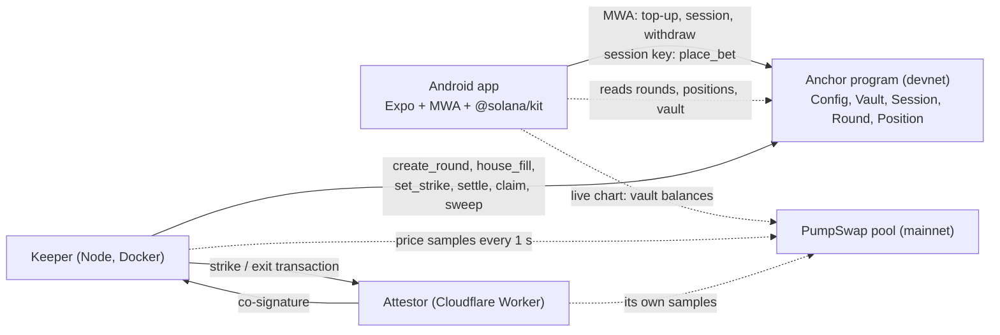

# FlipTheMeme

**UP/DOWN calls on the next 60-second move of a fresh Solana memecoin, matched 1:1 against the other side. Android app built for Seeker, money on Solana devnet, prices from mainnet PumpSwap pools.**

A fresh memecoin, a shared start, one measured minute of price move. You make the call without buying the token.

| | |
|---|---|
| Program (devnet) | [`5kUCKYAYxZyaSz18xEajhSDNwdXvVLp2AvBp4LDxWuCz`](https://explorer.solana.com/address/5kUCKYAYxZyaSz18xEajhSDNwdXvVLp2AvBp4LDxWuCz?cluster=devnet) |
| Config | [`A6k9oP8NT249nCM1g6DupAKgVT7dHLyGwbFn5VLbA8RQ`](https://explorer.solana.com/address/A6k9oP8NT249nCM1g6DupAKgVT7dHLyGwbFn5VLbA8RQ?cluster=devnet) |
| APK | [FlipTheMeme.apk](https://github.com/Sofiia7/flipthememe-solana/releases/latest/download/FlipTheMeme.apk), signed release (install page: https://sol.flipthememe.com/get) |
| Built for | Solana Mobile CLOCK IN · Solana Perps and Prediction Markets |
| Status | devnet MVP, test SOL only; see [Limits](#limits) |

## Try it on an Android phone

1. Install the APK. It is built and tested on a Solana Seeker.
2. Switch your wallet to devnet. On a Seeker the built-in **Seed Vault Wallet** works: Settings, Network, Devnet. **Solflare** works too. In our tests Phantom opened but did not return signatures over MWA.
3. Open FlipTheMeme. Watching needs no wallet. Tap **Connect**, then **Top up & play**: one wallet approval deposits test SOL into your in-app vault, opens a 7-day session and, when the device key runs low, sends it 0.03 SOL for fees and position rent. No devnet SOL? Use **Airdrop** in the Wallet tab or https://faucet.solana.com.
4. Pick an amount and tap **UP** or **DOWN**. That is one tap: the session key signs, no wallet pop-up.
5. The result comes roughly 100-160 seconds after your tap, plus confirmations, and the keeper credits your in-app balance (History offers a manual **Claim** if it is slow). **Withdraw** sends your available balance back to your wallet.

## How a round works

A new round opens at every UTC minute, so rounds overlap: while one measures its move, the next one takes calls. Times from the moment a round opens:

| Time | Phase | What happens |
|---|---|---|
| 0-60 s | Entry | calls are accepted until `cutoff_at`, enforced by the program clock |
| 60-90 s | Pause | entry is closed; on devnet the house may fill the smaller side |
| 90-100 s | Strike window | the strike is the mean of the pool price samples in this window |
| 150-160 s | Exit window | starts 60 s after the strike window starts; the exit price is the mean of its samples |
| after 160 s | Settle | the keeper posts the exit samples, the program decides UP, DOWN or a refund, then claims credit the vaults |

The 60 seconds is the measured move, from the start of the strike window to the start of the exit window. You call that move from a strike fixed after entry closes, not from the price on screen when you tap: a call at 12:00:05 in the round that opened at 12:00:00 compares the mean of 12:01:30-12:01:40 with the mean of 12:02:30-12:02:40. From a tap to the result is roughly 100-160 seconds plus transaction confirmations.

## The money rules

- **Matched 1:1.** `m = min(UP, DOWN)` plays on each side. The larger side's surplus comes back pro rata, without a fee.
- **x1.96 on the matched part.** A win pays 1.96x the matched part of your stake (2 x (1 - 2%)); the unmatched surplus comes back without a fee, win or lose. Example: you call UP with 0.10 SOL and the DOWN side ends at 0.02 SOL in total. Then 0.02 of your stake plays and 0.08 comes back. A win credits 0.08 + 1.96 x 0.02 = 0.1192 SOL, a profit of 0.0192 SOL before rent and network fees; a loss credits 0.08.
- **Fees.** 2% of the matched bank `2m` when a round ends UP or DOWN. Refunds are free since 5 October 2026: a tie, an unpriceable window (fewer than 5 price samples), a missed settle deadline or a round that never activated returns the full stake. The devnet config was changed to `fee_refund_bps = 0` in [this transaction](https://explorer.solana.com/tx/Cvi4ce8bW9bLnxXHQjRvsxSrQ6tKNx1dcRbxaCKDzo81urHX6bWJrupqpMvTXhpvKUtCKJCM4CBwp5SJRtvMQNv?cluster=devnet). Every round snapshots its fees when it is created, so rounds created before the change keep their 1% refund fee. The program caps fees at 2% on a result and 1% on a refund.
- **Activation.** A round plays only if both sides are present and the matched bank `2m` is at least 0.02 SOL; otherwise every stake comes back in full.
- **Depth cap.** When the keeper creates a round it sets a max bank: the smaller of the pool's SOL reserve / 2,500 and 1 SOL. The program refuses any bet that would push the matched bank `2m` above it. This limits what one round can win relative to the pool's depth; it does not prove that moving the price is unprofitable.
- **House on devnet.** After entry closes, a house account may fill the smaller side, shown as `HOUSE`. The program lets it add only to the smaller side and only up to the gap, and since 6 October 2026 caps it on chain (`HouseLimits`): 0.05 SOL per round over all house keys and 2 SOL per UTC day.

## Research behind the rules (not a Solana backtest)

The matched bank, the pause before the strike, the 1.96x payout, the 2% fee and the depth rule (K = 2,500) were carried over from research on an earlier version of this project on **Robinhood Chain**, not on Solana. Data: 743,127 swaps in 15 Uniswap v3 memecoin/WETH pools on Robinhood Chain mainnet (chain id 4663), 15-29 September 2026 (14 days). Strategies were fit on the first week and measured on the second.

- **Strike taken before the bet** (a 60-second average before the match), with a fixed-payout liquidity vault as the counterparty: a bot betting 2 s after a swap won 89.4% ± 0.7 of resolved 60-second matches (78.6% at 300 s, 74.6% at 900 s; a random side won 50%). Source: `SHARP-EDGE.md`.
- **Shared bank whose payout multiplier follows the book** (skew capped at 80:20): with simulated demand of 2-10 bets per hour per pool and bots taking up to 25% of the bank, ordinary players lost 9-22% of their accepted stake, mostly through the book's skew, which pays even a bettor with no price view. Source: `POSITIVE-EV.md`, `POOL-TOXICITY.md`.
- **Matched 1:1 bank, 300-second rounds, a 300-second pause, a 300-second strike window, 2% fee:** under the same bots, ordinary players lost 2.0% ± 0.3 of their accepted stake at 10 bets per hour, 2.2% ± 1.4 at 5 and 4.3% ± 3.8 at 2, against about 1.8% with no bot (the fee itself). Source: `POSITIVE-EV.md`.

These files and the scripts behind them are in the earlier MemePred repository (`docs/rhc/`, `scripts/rhc/`); they are not reproduced in this repository. The devnet timing here (60-second move, 30-second pause, 10-second strike window) was not part of that research, so there is no measured bot edge for it, and no Solana backtest has been run yet.

## Price source and trust

- **Price is TOKEN/SOL.** `price = quote_vault_amount * 10^12 / base_vault_amount`: the pool's wSOL reserve over its token reserve, read from the two vault token accounts every second at `confirmed`. A round compares the token's price in SOL, not in USD: if over the measured minute the token gains 3% in USD while SOL gains 5%, TOKEN/SOL falls by about 1.9% and DOWN wins.
- **Pool:** PumpSwap AMM (`pAMMBay6oceH9fJKBRHGP5D4bD4sWpmSwMn52FMfXEA`) on mainnet, quote = wSOL.
- **Token choice.** The keeper finds tokens through GeckoTerminal (the 5-minute trending list first) and prefers PumpSwap pools 10-120 minutes old, with 50+ trades in the last 5 minutes, whose base mint ends in `pump` (the pump.fun address suffix: a sign of a pump.fun graduate, not proof). It ranks them by activity with a bonus for youth, checks the pool on chain every minute (owner, mints, at least 50 SOL reserve), keeps a token at least 10 minutes, and moves on when a clearly busier one appears or the current one fades. If nothing fresh qualifies, it widens the age to 6 h, then 24 h, then any age, so the arena token is not always a fresh launch. The age shown is the pool's age, not a verified graduation time.
- **Samples.** Every observation used (mainnet slot and price, at least 5 and up to 16 per window) is passed to `set_strike` / `settle`. The program checks that the slots increase and the prices are positive, then takes the plain integer mean (not a time-weighted average). The samples stay in the transaction, so anyone can compare them with the pool's history.
- **Second signer.** The devnet program cannot read mainnet, so it cannot prove by itself that the samples came from that pool at those slots. An independent attestor (`services/attestor`, a Cloudflare Worker with its own key) samples the same pool on its own and co-signs a strike or exit only when the keeper's samples agree with its reads: exactly at every slot both read, and within 1.5% on the mean. `OracleConfig.required` is on (devnet, since 6 October 2026), so the program refuses a price without that signature, and the admin key alone cannot switch the attestor off or replace it: that needs the attestor's own signature.
- **Keys.** Since 6 October 2026 the roles sit on separate keys: one prices rounds, one funds the house, fees go to a separate treasury, and the keeper key stays admin and fee payer. The program's upgrade authority is a separate key that never leaves the developer's machine, so a stolen keeper key cannot replace the program.
- **Trust boundary.** Both the keeper and the attestor are run by us, so the second signer protects against a stolen or buggy price key, not against both operators at once. The money side is on chain: settlement math, payouts, session limits, the depth cap and the house caps. Claims are permissionless and always pay into the position owner's vault, and if a round is not settled within 600 s after its exit window, anyone can call `refund_expired`, so a withheld price ends in a refund, never in a wrong result.

## Architecture



There is no game server: the phone polls devnet and mainnet RPC directly (no indexer), and the keeper only cranks. Three Cloudflare Workers sit on the side: `services/attestor` samples the pool by itself and co-signs prices, `services/link` serves shared round pages and Android App Links, `services/chatter` serves X posts about the arena token.

## Mobile-first details

- **One approval:** Mobile Wallet Adapter signs a single transaction with `open_vault` (first time), `deposit`, `start_session` (7 days, max 0.1 SOL per bet, budget = top-up) and, when the device key runs low, a 0.03 SOL transfer to it for fees and position rent.
- **One-tap bets:** an ed25519 session key generated on the device and stored in Android secure storage. The program checks its per-bet limit, budget and expiry, and has no instruction that lets a session key withdraw or raise its own limit. The Wallet tab lists every session of the wallet, on any device, with **Revoke** and **Revoke all**, and **Return to wallet** sends the device key's SOL back.
- **No double payments:** top up, renew, withdraw, revoke and return store their signature before they are sent. If the answer is lost, the button shows CHECKING until the chain says confirmed, refused or expired, and a bet with an unknown outcome stays pending until its signature settles.
- **History on the phone:** finished rounds are kept on the phone per wallet, so History and Profile still show them after their position accounts are closed and the rent has gone back.
- **Your round stays on screen:** while a round of yours plays, the token header, the X lane and the chart follow its coin and its strike line, even when the next round already runs on another coin; the bar above the bet buttons names the next round's coin. Polling slows down on other tabs and stops in the background.
- **A new install needs no new deposit:** a reinstall makes a new device key, and the Wallet tab offers **Play with my balance**: one approval for a session over the game balance, no SOL moved.
- **Pixel faces:** 8 bytes that ride inside every `place_bet`, so other players see your face without NFTs or extra transactions.
- **Share:** challenge a friend to take the other side. The card goes out as an image with a link, `https://sol.flipthememe.com/r/<round>` (served by `services/link`); Android App Links open the app on that round, and without the app the page offers the APK. Entry closes within a minute, so a friend who still has to install will usually meet you in a later round.
- **Live X chatter:** a Cloudflare Worker (`services/chatter`) searches X for the arena token and the app slides the posts into a lane above the token. The MOON and SCAM tags come from the app's own keyword rules, not from the authors, so they can misread a post. It is decoration: nothing in the game or in settlement reads it.
- **Wallet recovery:** when the wallet rejects a cached authorization (expired, or issued to an earlier install), the app asks again in a new MWA session instead of failing every approval.

## Program

`programs/flip-the-meme` (Anchor 1.1.2): `initialize_config`, `update_config`, `set_pause`, `open_vault`, `deposit`, `withdraw`, `start_session`, `revoke_session`, `create_round`, `place_bet`, `house_fill`, `set_strike`, `settle`, `refund_expired`, `claim`, `sweep_fees`, `close_empty_round`, `close_position`, `init_house_limits`, `update_house_limits`, `init_oracle`, `set_oracle`. Pause stops new bets only; settlement, refunds, claims and withdrawals keep working. Stake limits, the minimum bank and the fees are copied into each round when it is created, so a config update changes them only for later rounds.

Tests:

- `cargo test --manifest-path programs/flip-the-meme/Cargo.toml --lib`: payout math, including "payouts never exceed the bank" over 1,000 random books.
- `cargo test --manifest-path programs/flip-the-meme/Cargo.toml --test flow`: 29 LiteSVM scenarios against the compiled program (surplus and 1.96x, house fill windows, not activated, tie, unpriceable, malformed samples, expiry refund by anyone, single claim and settle, cutoff on the program clock, session budget, expiry and revocation, foreign vault, depth cap, locked stake, pause, admin-only rounds, empty-round close, config snapshots, closing paid positions, house caps per round and per day, the attestor as a required second signer, and an admin key that cannot weaken it alone).
- `cargo test --manifest-path programs/flip-the-meme/Cargo.toml --test vectors` writes the exact instruction and account bytes that `packages/client` is checked against.

## Repository

```
programs/flip-the-meme   Anchor program, payout math, LiteSVM tests
packages/client          TypeScript client on @solana/kit: PDAs, codecs, instructions, payout mirror, PumpSwap price source
packages/arena-core      legacy: the September pari-mutuel model, not used by the program (kept for history)
services/keeper          round crank: pool selection, sampler, scheduler, house budget, position closer, Docker deploy
services/attestor        Cloudflare Worker: independent price co-signer (own samples, co-signs set_strike / settle)
services/chatter         Cloudflare Worker: live X posts about the arena token, tagged MOON / SCAM by keyword rules
services/link            Cloudflare Worker on sol.flipthememe.com: round link pages and Android App Links
apps/mobile              Expo 57 / React Native 0.86 Android app
docs                     design, plan, submission materials (older documents are marked superseded)
```

## Build and test from source

Prerequisites: Node 22+, pnpm 11 (`corepack enable`), Rust, Agave 3.1.14 for `cargo build-sbf`.

```bash
corepack pnpm install
corepack pnpm test
corepack pnpm --filter @flipthememe/mobile typecheck
cargo build-sbf --manifest-path programs/flip-the-meme/Cargo.toml
cargo test --manifest-path programs/flip-the-meme/Cargo.toml
```

`corepack pnpm test` runs the current TypeScript suites with `node --test`: the client, keeper, chatter and link services, and the mobile helper tests (`apps/mobile/src/__tests__`, no device or UI tests). `corepack pnpm run test:legacy` runs the tests of the legacy `packages/arena-core` model, which says nothing about the current economics.

The APK is built by `.github/workflows/android.yml` (`expo prebuild` + Gradle, release signing from repository secrets) and also produces a debug development client.

## Limits

Devnet only, test SOL only, no external audit. Known limits of this build:

- **Price trust.** The attestor checks every strike and exit against its own reads, but it and the keeper are both run by us, the devnet program still cannot read mainnet, and the mean is plain, not time-weighted. The keeper key remains admin: it can pause betting, create rounds and change Config.
- **Position rent.** Every bet opens a 100-byte position account (about 0.00116 SOL, paid by the device key). Once the round is final and paid, the keeper closes it a day later and the rent goes back to the wallet (the program allows it after an hour). On a 0.01 SOL stake the rent is about 11.6% of the stake until it comes back.
- **History is local.** Finished rounds are kept on the phone that saw them. A round played from another phone, or closed while the app stayed shut for more than a day, is missing from History.
- **Sessions are per install.** The session key lives in one app install, so a reinstall needs a new top-up or session. The wallet that owns the vault can still withdraw.
- **Reads.** The app polls RPC (no indexer), and the chart starts when the app opens.
- **Round timing.** The devnet timing (60-second move, 30-second pause, 10-second strike window) was chosen for the mobile feel and has not been measured against bots (see the research section). Round length for real money should come from measurements on Solana data.
- **Chatter.** X posts are decoration, and their MOON/SCAM tags come from keyword rules.
