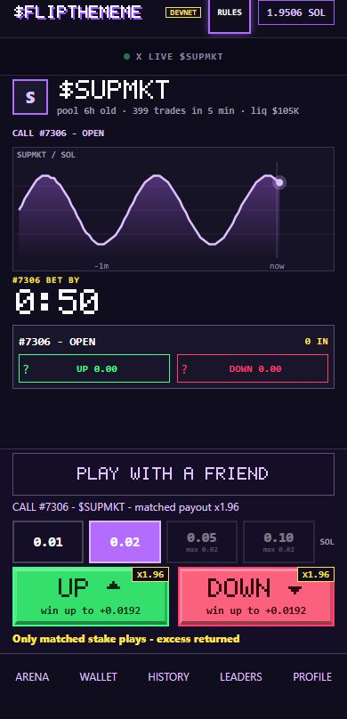
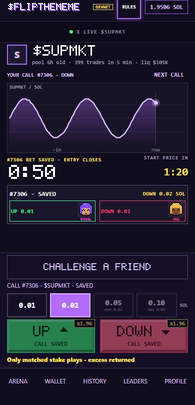
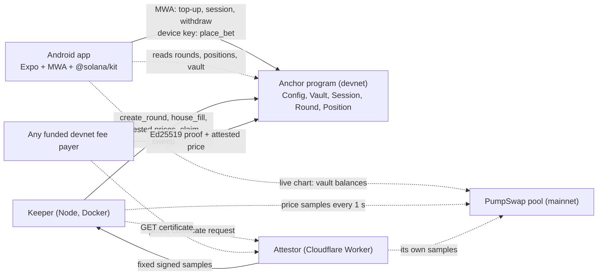

# FlipTheMeme

**UP/DOWN calls on the next 1-minute move of a busy Solana memecoin, matched 1:1 against the other side. Android app built for Seeker, money on Solana devnet, prices from mainnet PumpSwap pools.**

A busy memecoin, a shared start, one measured minute of price move. You make the call without buying the token. A 1-minute move, result in about 2 minutes.

**How to play.** Install the APK and switch your wallet to devnet. Tap **UP** or **DOWN**: the app connects your wallet and asks for one approval that tops up and opens your session. After that every call is one tap, no wallet pop-up. The result lands in about 2 minutes and the keeper credits your in-app balance. **Withdraw** sends it back to your wallet.

**Why it is different.**

- **Matched 1:1, one payout.** Only the amount both sides cover plays. A win pays 1.96x the matched part, the unmatched surplus comes back without a fee, so betting both sides of a lopsided book only costs the fee. No odds follow the book.
- **The start price is not the price you tapped at.** It is fixed after entry closes, so nobody calls a price they already see.
- **Public price certificates.** The attestor fixes its own measured samples once per round and window. Anyone can relay its signed certificate; the program verifies the signature and exact round, pool, window and samples. The keeper cannot choose a subset or monopolize submission. See [the certificate protocol](docs/price-certificates.md).
- **Built around the phone.** One wallet approval opens a limited session (one hour and 0.02 SOL per bet by default, longer choices available) for a device key that can place bets up to a per-bet limit and has no instruction to withdraw. Seed Vault Wallet on Seeker works.
- **Honest about what it is.** Devnet, test SOL, no audit. [Limits](#limits) lists what is not solved, including the two that matter most for money: the price attestor is run by us, and the program's upgrade authority is full custody of the deposits.
- **Leaderboard.** The app's LEADERS tab and [public ranking](https://sol.flipthememe.com/leaderboard) show the top 200 players by net test SOL over the last seven days. Returns minus stakes include game fees but exclude transaction fees and account rent. House positions never enter the ranking; refunds do not count as wins or losses. A read-only keeper indexer captures confirmed final positions every two minutes, saves them in `/data/leaderboard.json`, and signs snapshots with the keeper key for the link Worker's KV store. Restarts and closing accounts do not erase captured results. Earlier bets whose accounts were already closed before tracking began cannot be recovered by this indexer. Player rows include the pixel face from their latest indexed position; your own row uses your current local face. Old closed positions without captured face bytes show a placeholder. The screen shows the tracking start, update time, delayed updates, and the UP/DOWN counts of the keeper's minute-by-minute market sample; those counts are not assumed to be 50/50.

| | |
|---|---|
| Program (devnet) | [`5kUCKYAYxZyaSz18xEajhSDNwdXvVLp2AvBp4LDxWuCz`](https://explorer.solana.com/address/5kUCKYAYxZyaSz18xEajhSDNwdXvVLp2AvBp4LDxWuCz?cluster=devnet) |
| Config | [`A6k9oP8NT249nCM1g6DupAKgVT7dHLyGwbFn5VLbA8RQ`](https://explorer.solana.com/address/A6k9oP8NT249nCM1g6DupAKgVT7dHLyGwbFn5VLbA8RQ?cluster=devnet) |
| APK | [FlipTheMeme.apk](https://github.com/Sofiia7/flipthememe-apk/releases/latest/download/FlipTheMeme.apk), signed release (install page: https://sol.flipthememe.com/get) |
| Built for | Solana Mobile CLOCK IN · Solana Perps and Prediction Markets |
| Status | devnet MVP, test SOL only; see [Limits](#limits) |


## Status

Devnet MVP, test SOL only. The install page [sol.flipthememe.com/get](https://sol.flipthememe.com/get) names the published APK with its version and SHA-256. Release evidence and the history of the audit passes: [release history](docs/release-history.md), [Android acceptance](docs/android-acceptance.md), [Solana validation](docs/research/solana-validation.md), [submission text](docs/submission/submission-texts.md). A passing CI build is not the same as acceptance on a physical Seeker; the acceptance matrix records which builds were checked on a device. The first round between two people on two phones was [round 8723](https://explorer.solana.com/address/DWrxSr4hsoXUaKqHaycLT5FnQRGCXQX97naNF785auyg?cluster=devnet) on 12 October: 0.02 SOL UP against 0.02 SOL DOWN, no house stake, settled DOWN. Founder testing on devnet, not organic demand.

## Screens

<table>
  <tr>
    <td></td>
    <td></td>
  </tr>
</table>

<sub>Arena states rendered from the app's own components with fixture data at 390x844: no wallet, no transactions, not photographs of a device.</sub>

## Try it on an Android phone

1. Install the signed arm64 Android APK. New candidates are checked on Seeker through a LAN download page before publication; the public release can lag the source.
2. Switch your wallet to devnet. On a Seeker the built-in **Seed Vault Wallet** works: Settings, Network, Devnet. **Solflare** and **Jupiter Mobile** work too (Jupiter checked on a second phone on 12 October). In our tests Phantom opened but did not return signatures over MWA.
3. Open FlipTheMeme. Watching needs no wallet. Tap **UP** or **DOWN** (or **Connect**, then **Top up & play**): one wallet trip (connect, then sign) and your original call goes in after approval only if that same round is still open and the exact amount still fits. The approval deposits test SOL into your in-app vault, opens the session whose limits you selected and, when the device key runs low, sends it 0.005 SOL for network fees (about 800 bets). No devnet SOL? Tap **GET TEST SOL** in the top-up sheet (0.2 devnet SOL, once your wallet holds less than 0.1), or use **Airdrop** in the Wallet tab or https://faucet.solana.com. When you leave the app with a round in play, a local reminder invites you back about 15 seconds after its scheduled exit window. It does not claim that settlement has confirmed or tell you who won.
4. Pick an amount and tap **UP** or **DOWN**. That is one tap: the device key signs, no wallet pop-up.
5. The result comes in about 2 minutes after your tap (a 1-minute move, plus confirmations), and the keeper credits your in-app balance (History offers a manual **Claim** if it is slow). **Withdraw** sends your available balance back to your wallet.

## How a round works

When a valid liquid pool is available, a new round opens at each UTC minute, so rounds overlap: while one measures its move, the next one takes calls. Times from the moment a round opens:

| Time | Phase | What happens |
|---|---|---|
| 0-60 s | Entry | calls are accepted until `cutoff_at`, enforced by the program clock |
| 60-90 s | Pause | entry is closed; on devnet the house may fill the smaller side |
| 90-100 s | Reference window | the reference price (the program's strike) is the mean of the pool price samples in this window |
| 150-160 s | Exit window | starts 60 s after the strike window starts; the exit price is the mean of its samples |
| after 160 s | Settle | anyone relays the attestor's exit certificate; the program decides UP, DOWN or a refund, then claims credit the vaults |

The app keeps **YOUR BET #<round>** above the chart and explains each phase: bet saved, waiting for entry to close, measuring the reference price, confirming it, measuring the move, measuring the final average, and confirming the result. The fixed reference is taken after entry closes; it is not the price when you tapped. The **NEW BET** dock names its own round and token, so a call in the next round is separate from the one already playing.

The 60 seconds is the measured move, from the start of the strike window to the start of the exit window. You call that move from a strike fixed after entry closes, not from the price on screen when you tap: a call at 12:00:05 in the round that opened at 12:00:00 compares the mean of 12:01:30-12:01:40 with the mean of 12:02:30-12:02:40. From a tap to the result is about 2 minutes: roughly 100-160 seconds plus transaction confirmations.

The program accepts the strike only from 100 s up to, but not including, 150 s after the round opens (`strike_end <= now < exit_start`): once the exit window has begun the exit price is on its way, so a strike could be chosen with it in view. A round whose strike is missed stays open and ends through `refund_expired` after its settle deadline. `create_round` also bounds every round on chain: at most 15 minutes from opening to the end of the exit window, a settle deadline at most one hour after it, and a bank cap of at least the minimum bank, so even a compromised admin key cannot hold bets for long.

## The money rules

- **Matched 1:1.** `m = min(UP, DOWN)` plays on each side. The larger side's surplus comes back pro rata, without a fee.
- **x1.96 on the matched part.** A win pays 1.96x the matched part of your stake (2 x (1 - 2%)); the unmatched surplus comes back without a fee, win or lose. Example: you call UP with 0.10 SOL and the DOWN side ends at 0.02 SOL in total. Then 0.02 of your stake plays and 0.08 comes back. A win credits 0.08 + 1.96 x 0.02 = 0.1192 SOL, a profit of 0.0192 SOL before rent and network fees; a loss credits 0.08.
- **Fees.** 2% of the matched bank `2m` when a round ends UP or DOWN. Refunds are free since 5 October 2026: a tie, an unpriceable window (fewer than 5 price samples), a missed settle deadline or a round that never activated returns each player's full stake; the house forfeiture rule below additionally applies to Unpriceable and Expired rounds. The devnet config was changed to `fee_refund_bps = 0` in [this transaction](https://explorer.solana.com/tx/Cvi4ce8bW9bLnxXHQjRvsxSrQ6tKNx1dcRbxaCKDzo81urHX6bWJrupqpMvTXhpvKUtCKJCM4CBwp5SJRtvMQNv?cluster=devnet). Every round snapshots its fees when it is created, so rounds created before the change keep their 1% refund fee. The program caps fees at 2% on a result and 1% on a refund.
- **Activation.** A round plays only if both sides are present and the matched bank `2m` is at least 0.02 SOL; otherwise every stake comes back in full.
- **Depth cap.** When the keeper creates a round it sets a max bank: the smaller of 1 SOL and the pool's SOL reserve / 2,500 minus the maximum banks of other unfinished rounds on that pool. The aggregate subtraction is a keeper scheduling policy; the program enforces only the individual round cap. The program refuses any bet that would push the matched bank `2m` above it. This limits what one round can win relative to the pool's depth; it does not prove that moving the price is unprofitable.
- **House on devnet.** After entry closes, a house account may fill the smaller side, shown as `HOUSE`. The program lets it add only to the smaller side and only up to the gap, and since 6 October 2026 caps it on chain (`HouseLimits`): 0.05 SOL per round over all house keys and 2 SOL per UTC day. If a matched round ends without a price, either because the window is unpriceable (fewer than 5 samples) or because the settle deadline passes, the house position forfeits its stake and the other positions share it pro rata to their stakes (floors only, rounding dust goes to the treasury), so withholding a price is never better for the house than losing it. A tie and a round that never activated return the house its stake. The house cannot fill while betting is paused.

<details>
<summary><b>Research behind the rules (not a Solana backtest)</b></summary>

The matched bank, the pause before the strike, the 1.96x payout, the 2% fee and the depth rule (K = 2,500) were carried over from research on an earlier version of this project on **Robinhood Chain**, not on Solana. Data: 743,127 swaps in 15 Uniswap v3 memecoin/WETH pools on Robinhood Chain mainnet (chain id 4663), 15-29 September 2026 (14 days). Strategies were fit on the first week and measured on the second.

- **Strike taken before the bet** (a 60-second average before the match), with a fixed-payout liquidity vault as the counterparty: a bot betting 2 s after a swap won 89.4% ± 0.7 of resolved 60-second matches (78.6% at 300 s, 74.6% at 900 s; a random side won 50%). Source: `SHARP-EDGE.md`.
- **Shared bank whose payout multiplier follows the book** (skew capped at 80:20): with simulated demand of 2-10 bets per hour per pool and bots taking up to 25% of the bank, ordinary players lost 9-22% of their accepted stake, mostly through the book's skew, which pays even a bettor with no price view. Source: `POSITIVE-EV.md`, `POOL-TOXICITY.md`.
- **Matched 1:1 bank, 300-second rounds, a 300-second pause, a 300-second strike window, 2% fee:** under the same bots, ordinary players lost 2.0% ± 0.3 of their accepted stake at 10 bets per hour, 2.2% ± 1.4 at 5 and 4.3% ± 3.8 at 2, against about 1.8% with no bot (the fee itself). Source: `POSITIVE-EV.md`.

These files and the scripts behind them are in the earlier MemePred repository (`docs/rhc/`, `scripts/rhc/`); they are not reproduced in this repository. The devnet timing here (60-second move, 30-second pause, 10-second strike window) was not part of that research, so there is no measured bot edge for it, and no Solana backtest has been run yet.

</details>

## Price source and trust

- **Price is TOKEN/SOL.** `price = quote_vault_amount * 10^12 / base_vault_amount`: the pool's wSOL reserve over its token reserve, read from the two vault token accounts every second at `confirmed`. A round compares the token's price in SOL, not in USD: if over the measured minute the token gains 3% in USD while SOL gains 5%, TOKEN/SOL falls by about 1.9% and DOWN wins.
- **Pool:** PumpSwap AMM (`pAMMBay6oceH9fJKBRHGP5D4bD4sWpmSwMn52FMfXEA`) on mainnet, quote = wSOL.
- **Token choice.** Production uses continuous rounds with a measured reserve (`POOL_BALANCED=true`, `POOL_NEUTRAL=false`). Up to six pools of distinct base tokens, including the current one, pass on-chain token and depth checks and are observed in parallel. Ten directional samples establish measured readiness; symmetric momentum, buy/sell imbalance and five-minute drift rank the next market rather than stop round creation. A prepared balanced reserve replaces a biased current pool even during its hold. If no better pool exists, a valid current market continues; genuine token/depth failures still require a safe replacement. Trending and the youth score bonus remain disabled. Discovery scans five activity pages, keeps refreshing reserve addresses beyond the new-token age window, and isolates failures of the new-pools endpoint. Mature reserves may use mints without the vanity `pump` suffix but pass the same token checks. Background price reads run around synchronized measurement windows. Candidate-only observations are excluded from public arena statistics. This reduces selection bias; market outcomes are not guaranteed to be 50/50. `POOL_NEUTRAL=true` remains an optional strict mode that can create gaps.
- **Samples.** The attestor chooses the first positive observation inside `[start, end)` at each confirmed mainnet slot, orders by slot and keeps at most 16. Its SQLite certificate row is fixed before signing, including across retries and restarts. The program checks increasing slots and positive prices and takes the plain integer mean; fewer than five samples mean an unpriceable refund. Samples remain in the transaction. Callers cannot submit their own subset.
- **Price attestor.** The public `GET /v1/attestation?round=<id>&kind=strike|exit` returns a certificate bound to this devnet program, round PDA, pool, kind and exact measurement window. `set_strike_attested` and `settle_attested` verify a preceding native Ed25519 instruction against OracleConfig. Only a funded fee payer is needed; no keeper, price-authority or attestor transaction signature is required. With `OracleConfig.required=true`, the previous priced instructions are refused as `DetachedPriceRequired`. The old authenticated co-signing route remains for pre-upgrade compatibility; its 150 bps tolerance and 60% keeper coverage do not apply to canonical certificates. Replacing or disabling a required attestor still needs the current attestor's authorization as well as the admin.
- **Keys.** Since 6 October 2026 the roles sit on separate keys: one prices rounds, one funds the house, fees go to a separate treasury, and the keeper key stays admin and fee payer. The program's upgrade authority is a separate key that never leaves the developer's machine, so a stolen keeper key cannot replace the program.
- **Trust boundary.** The devnet program cannot independently read mainnet or prove when a mainnet slot occurred. The attestor and its RPC providers remain trusted; its certificate key alone can authorize a false price if compromised. The keeper and attestor are operated by the maintainer. Settlement math, payouts, session limits, depth caps and house caps are enforced on chain. Claims and certificate relaying are permissionless; claims always pay the position owner's vault. After the devnet deadline (600 seconds after exit), anyone can call `refund_expired`. The house forfeits its stake on Expired and Unpriceable, while player refund fees are zero.

## Architecture



The phone reads rounds, positions and live chart prices directly from Solana RPC. The keeper cranks rounds and maintains the read-only leaderboard index; funds stay in program vaults. Three Cloudflare Workers sit on the side: `services/attestor` samples the pool and issues public price certificates, `services/link` serves shared round pages and Android App Links and hands out devnet test SOL (`POST /v1/faucet`, 0.2 SOL to a wallet that holds less than 0.1, from a separate funded key), `services/chatter` serves X posts about the arena token.

<details>
<summary><b>Mobile-first details</b></summary>

- **One approval:** Mobile Wallet Adapter signs a single transaction with `open_vault` (first time), `deposit`, `start_session` (selected duration and maximum bet; default one hour, 0.02 SOL per bet and one base unit of turnover, with optional one-day/10× and seven-day/100× permissions, because the program counts every stake cumulatively and never subtracts what comes back: the allowance limits how often the key can bet, not how much it can lose, since bets come out of the vault) and, when the device key runs low, a 0.005 SOL transfer to it for network fees. Position rent comes from the game balance and goes back to it.
- **One-tap bets:** an ed25519 device key generated on the phone and stored in Android secure storage. The program checks its per-bet limit, turnover allowance and expiry, and has no instruction that lets the device key withdraw or raise its own limit. The Wallet tab lists every session of the wallet, on any device, with **Revoke** and **Revoke all**, and **Return to wallet** sends the device key's SOL back.
- **No double payments:** top up, renew, withdraw, revoke and return store their signature before they are sent. If the answer is lost, the button shows CHECKING until the chain says confirmed, refused or expired, and a bet with an unknown outcome stays pending until its signature settles.
- **History on the phone:** finished rounds are kept on the phone per wallet, so History and Profile still show them after their position accounts are closed and the rent has gone back.
- **Reasons to come back:** streaks, a pixel daily ring showing wins among finished calls, the public seven-day leaderboard, a persistent score against a challenged friend (last 200 observed duels, isolated per wallet pair on this device), one-tap SAME CALL / FLIP IT, and local reminders after leaving the app. Reminders never invent a result; confirmed outcomes are read from the chain when the app returns.
- **Your round stays on screen:** while a round of yours plays, the token header, the X lane and the chart follow its coin and its strike line, even when the next round already runs on another coin; the bar above the bet buttons names the next round's coin. Polling slows down on other tabs and stops in the background. The phase card separates your saved bet from the next round; returning to the app shows missed results. The chart is memoized and its clock redraws at most once a second; battery and frame-time measurements on the new Seeker build are still a device acceptance check.
- **A new install needs no new deposit:** a reinstall makes a new device key, and the Wallet tab offers **Play with my balance**: one approval for a session over the game balance, no SOL moved.
- **Pixel faces:** 8 bytes that ride inside every `place_bet`, so other players see your face without NFTs or extra transactions.
- **Share:** challenge a friend to take the other side, any time: rounds start every minute while an valid liquid pool is available, so the link (`https://sol.flipthememe.com/r/<round>?side=up&t=<ticker>&by=<wallet>&n=<name>`, served by `services/link`) invites them to meet you in a later round and keeps the challenge through installing the APK. The app keeps it for a week, shows how that round went and the round open now, and tags the friend's face RIVAL when you meet; calls are still matched in one shared bank, and nothing from the link places a bet. Outside a bet the same place on the Arena offers **Play with a friend**: an invitation card and a link without a side (`?by=<wallet>&n=<name>`) that lands on an invite page and, in the friend's app, on the round open now.
- **Live X chatter:** a Cloudflare Worker (`services/chatter`) searches X for the arena token and the app slides the posts into a lane above the token. The MOON and SCAM tags come from the app's own keyword rules, not from the authors, so they can misread a post. It is decoration: nothing in the game or in settlement reads it.
- **Wallet recovery:** when the wallet rejects a cached authorization (expired, or issued to an earlier install), the app asks again in a new MWA session instead of failing every approval.

</details>

<details>
<summary><b>Program and its tests</b></summary>

`programs/flip-the-meme` (Anchor 1.1.2): `initialize_config`, `update_config`, `set_pause`, `open_vault`, `deposit`, `withdraw`, `start_session`, `revoke_session`, `close_session`, `create_round`, `place_bet`, `house_fill`, `set_strike_attested`, `settle_attested`, `set_strike` (legacy), `settle` (legacy), `refund_expired`, `claim`, `sweep_fees`, `close_empty_round`, `close_position`, `init_house_limits`, `update_house_limits`, `init_oracle`, `set_oracle`. Pause stops new bets and house fills; settlement, refunds, claims and withdrawals keep working. `create_round` refuses a round that opens more than 15 minutes ahead, and `close_empty_round` can be sent by anyone (the rent still goes to the admin). The program embeds a `security.txt` (see [SECURITY.md](SECURITY.md)). Stake limits, the minimum bank and the fees are copied into each round when it is created, so a config update changes them only for later rounds.

Tests:

- `cargo test --manifest-path programs/flip-the-meme/Cargo.toml --lib`: payout math and program unit checks, including "payouts never exceed the bank" over random books, with and without a house position in an expired round.
- `cargo test --manifest-path programs/flip-the-meme/Cargo.toml --test flow`: 74 LiteSVM scenarios against the compiled program (surplus and 1.96x, the strike window to the second, the settle deadline to the second, bounded round times and an opening time bounded ahead, the house forfeiting its stake on expiry and on an unpriceable window but not on a tie or a round that never activated, house fills refused on pause, odd stakes with 8 and 10 players on one side through claim and sweep, rotating the price authority and the treasury mid-round, fee-free refunds at 0 bps, house fill windows, not activated, tie, unpriceable, malformed samples, expiry refund by anyone, single claim and settle, cutoff on the program clock, session budget, expiry and revocation, foreign vault, depth cap, locked stake, pause, admin-only rounds, closing played rounds after their positions, closing sessions and getting their rent back, config snapshots, closing paid positions, position rent taken from and returned to the game balance, house caps per round and per day, required canonical attestor proofs and permissionless relaying, and an admin key that cannot weaken it alone).
- `cargo test --manifest-path programs/flip-the-meme/Cargo.toml --test vectors` writes the exact instruction and account bytes that `packages/client` is checked against.

</details>

## Repository

```
programs/flip-the-meme   Anchor program, payout math, LiteSVM tests
packages/client          TypeScript client on @solana/kit: PDAs, codecs, instructions, payout mirror, PumpSwap price source
packages/arena-core      legacy: the September pari-mutuel model, not used by the program (kept for history)
services/keeper          round crank: pool selection, sampler, scheduler, house budget, position closer, Docker deploy
services/attestor        Cloudflare Worker: own mainnet sampler, immutable signed price certificates
services/chatter         Cloudflare Worker: live X posts about the arena token, tagged MOON / SCAM by keyword rules
services/link            Cloudflare Worker on sol.flipthememe.com: round link pages, Android App Links, devnet test-SOL faucet
apps/mobile              Expo 57 / React Native 0.86 Android app
docs                     current design and plan, submission materials; docs/archive holds the superseded September documents
```

## Build and test from source

Prerequisites: Node 22+, pnpm 11 (`corepack enable`), Rust, Agave 3.1.14 for `cargo build-sbf`.

```bash
corepack pnpm install
corepack pnpm test
corepack pnpm --filter @flipthememe/mobile typecheck
cargo build-sbf --manifest-path programs/flip-the-meme/Cargo.toml
cargo test --manifest-path programs/flip-the-meme/Cargo.toml
```

`corepack pnpm test` runs the current TypeScript suites with `node --test`: the client, keeper, attestor, chatter and link services, and the mobile helper tests (`apps/mobile/src/__tests__`, no device or UI tests). `corepack pnpm run test:legacy` runs the tests of the legacy `packages/arena-core` model, which says nothing about the current economics.

The APK is built by `.github/workflows/android.yml` (`expo prebuild` + Gradle, release signing from repository secrets, arm64-v8a only unless the `abis` input asks for more such as x86_64 for the emulator) and also produces a debug development client. `.github/workflows/ci.yml` runs the TypeScript tests and the app typecheck on every push to main and every pull request; the manually dispatched `.github/workflows/program.yml` performs two clean SBF builds in a Docker image pinned by digest, compares their binaries, generates the IDL and runs the Rust tests against that identical binary. `programs/flip-the-meme/build-verifiable.sh` reproduces the check locally. The `verified-program` artifact contains the binary, IDL, SHA-256 manifest, source commit and build-image identity. The optional migration test against a previous live binary needs `FTM_LIVE_SO` and is otherwise ignored.

## Limits

Devnet only, test SOL only, no external audit. Known limits of this build:

- **Price trust.** The attestor fixes and signs its own observed samples, but it is run by us and the program cannot read mainnet. Its key alone can authorize false prices; this is the trust tradeoff of permissionless relaying, not a decentralized oracle. The mean is plain rather than time-weighted. The keeper key remains admin: it can pause betting, create rounds and change Config.
- **Position rent.** Every bet opens a 100-byte position account whose rent (about 0.00116 SOL) is held from the game balance. Once the round is final and paid, the keeper closes the account a day later and the rent goes back into the game balance (the program allows it after an hour). On a 0.01 SOL stake that is about 11.6% of the stake, parked for a day. Closing a position also takes it off the round's position count, so once the last one is closed and the round's fees are swept the keeper closes the round account too and takes its rent back. Rounds whose positions were closed by the older program keep their account, because their count never went down.
- **History is local.** Finished rounds are kept on the phone that saw them. A round played from another phone, or closed while the app stayed shut for more than a day, is missing from History.
- **Sessions are per install.** The device key lives in one app install, so a reinstall needs a new top-up or session. The wallet that owns the vault can still withdraw. Old sessions (revoked or expired) can be closed from the Wallet tab (ADVANCED, PLAY SESSIONS): each returns its rent of about 0.0013 SOL to the owner.
- **Reads.** The arena polls RPC directly; the leaderboard uses a separate read-only indexer. The chart history starts when the app opens.
- **Round timing.** The devnet timing (60-second move, 30-second pause, 10-second strike window) was chosen for the mobile feel and has not been measured against bots (see "Research behind the rules"). Round length for real money should come from measurements on Solana data.
- **Chatter.** X posts are decoration, and their MOON/SCAM tags come from keyword rules.
- **Pool selection is not a safety guarantee.** The keeper checks mint/freeze authorities, supported Token-2022 extension rules and the largest holder outside the pool. These checks do not detect all wash trading or make price manipulation unprofitable. The `pump` suffix is a vanity address anyone can grind, not proof of pump.fun origin. Warmup and symmetric momentum filters do not prove future directional balance; old UP-heavy samples remain visible in the public statistics.
- **Observation timing is trusted off chain.** The signature binds the exact round, pool, window and sample bytes, and the chain checks its own submission deadline. It cannot prove that mainnet slots and prices were observed at those wall-clock times; that remains the attestor's responsibility.
- **The upgrade authority is full custody.** Whoever holds the program's upgrade authority can replace the program and so move every deposit. Today it is one key held by the developer, separate from the keeper key. The plan before mainnet: a multisig and an external audit.
- **A missing price can mean a late refund.** A certificate with fewer than five attestor observations produces a free Unpriceable refund after the window. If no certificate is available, the free Expired refund waits until exit plus 600 seconds, about 12 minutes after opening. In both cases the house forfeits its matched stake.
- **The attestor can still withhold or fabricate a price.** The keeper no longer controls submission: anyone can fetch and relay the fixed certificate. The maintainer still controls the attestor key, and a holder of that key can fabricate a result or tie. An unavailable attestor leads to the normal deadline refund; permissionless relaying removes the keeper dependency, not the oracle dependency.
- **An attestor outage costs the house.** Expired and Unpriceable rounds forfeit the house stake to opposing players. The loss is bounded by on-chain house limits (0.05 SOL per round, 2 SOL per UTC day in the current config). Public relayers can continue without the keeper, but still need an attestor certificate.
- **The admin key cannot be rotated.** `Config.admin` is set once in `initialize_config`; there is no `set_admin`, so a lost or stolen admin key can only be replaced by upgrading the program. `initialize_config` is open to the first caller on a fresh deployment, which is why it must run in the same step as the deploy. Before mainnet: a two-step admin hand-over, the admin and the upgrade authority in a multisig.
- **Moving the price is cheaper than the prize.** Nudging a pool's price costs the manipulator roughly 13 times less than the largest possible win, at any pool depth. The depth cap bounds the absolute loss of one round, but it does not make manipulation unprofitable.
- **Devnet house fills are a bootstrap.** On devnet a house account fills the short side so a lone player still gets a matched round. The house is capped on chain (per round and per UTC day); the mainnet design does not rely on it.
