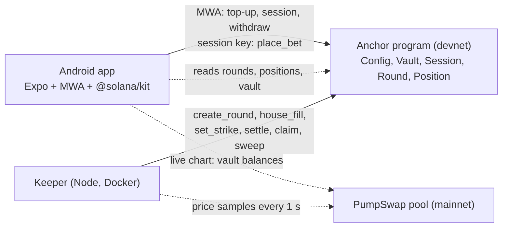

# FlipTheMeme

**60-second UP/DOWN calls on fresh Solana memecoins, matched 1:1 against other players. Android app built for Seeker, money on Solana devnet, prices from mainnet PumpSwap pools.**

A fresh memecoin. A shared start. One minute to prove your call, without buying the token.

| | |
|---|---|
| Program (devnet) | [`5kUCKYAYxZyaSz18xEajhSDNwdXvVLp2AvBp4LDxWuCz`](https://explorer.solana.com/address/5kUCKYAYxZyaSz18xEajhSDNwdXvVLp2AvBp4LDxWuCz?cluster=devnet) |
| Config | [`A6k9oP8NT249nCM1g6DupAKgVT7dHLyGwbFn5VLbA8RQ`](https://explorer.solana.com/address/A6k9oP8NT249nCM1g6DupAKgVT7dHLyGwbFn5VLbA8RQ?cluster=devnet) |
| APK | GitHub Actions artifact `FlipTheMeme-apk` (signed release) |
| Built for | Solana Mobile CLOCK IN · Solana Perps and Prediction Markets |

## Try it on an Android phone

1. Install the APK. Any Android 7+ phone works; it is built and tested on a Solana Seeker.
2. Switch your wallet to devnet: Phantom (Settings, Developer Settings, Testnet Mode, Solana Devnet) or Solflare (network: Devnet).
3. Open FlipTheMeme. Watching needs no wallet. Tap **Connect**, then **Top up & play**: one wallet approval deposits test SOL into your in-app vault and opens a 24-hour session. No devnet SOL? Use **Airdrop** in the Wallet tab or https://faucet.solana.com.
4. Pick an amount and tap **UP** or **DOWN**. That is one tap: the session key signs, no wallet pop-up.
5. About two minutes after entry closes the result is in and winnings are in your balance. **Withdraw** sends free SOL back to your wallet.

## How a round works

A new round opens at every UTC minute. While one round measures its move, the next one takes calls.

| Phase | Length | What happens |
|---|---|---|
| Entry | 60 s | calls are accepted until `cutoff_at`, enforced by the program clock |
| Pause | 30 s | nobody can enter; on devnet the house may match the short side |
| Strike window | 10 s | the strike is the mean of the pool price observed in this window |
| Move | 60 s | from the start of the strike window to the start of the exit window |
| Exit window | 10 s | the exit price is the mean of this window |
| Settle | seconds | the keeper posts the exit price and credits every position |

You call the move from a strike that is fixed after entry closes, never the price you see when you tap.

## The money rules

- **Matched 1:1.** `m = min(UP, DOWN)` plays on each side. The larger side's surplus comes back pro rata without a fee.
- **A win pays exactly 1.96x** of the stake that played, whatever the book looks like.
- **Fees:** 2% of the matched bank `2m` on an UP/DOWN result; 1% on a refund of an activated round (tie, too few price observations, missed deadline).
- **No match, no fee:** a round without both sides, or with a matched bank under 0.02 SOL, returns every stake in full.
- **Depth cap:** the matched bank may not exceed the pool's SOL reserve / 2,500, so a round can never be worth moving a thin pool.
- **House on devnet:** after entry closes, a house account may fill the short side up to a per-round cap and a daily budget, shown as `HOUSE`. It never takes the larger side.

Why these rules: an earlier version of this project backtested 743k real swaps from 15 memecoin pools over 14 days. With a strike taken before the bet, a bot betting 2 s after a swap won 89% of 60-second matches; with odds that follow the book, two-sided bettors profited from skew and ordinary players lost 9-22%. A matched bank plus a strike after a pause bring player loss down to the fee range on 300-second rounds. Devnet uses 60-second rounds for the mobile feel, where the measured bot edge is higher (about 7%); mainnet round length will follow the measurements.

## Price source and trust

- Pool type: PumpSwap AMM (`pAMMBay6oceH9fJKBRHGP5D4bD4sWpmSwMn52FMfXEA`) on mainnet, quote = wSOL. Fresh tokens are discovered through GeckoTerminal: pools 10-120 minutes old with 50+ trades in the last 5 minutes, ranked by activity with a bonus for youth. The keeper keeps a token at least 10 minutes, then moves on when a clearly busier one appears or the current one fades, and checks the pool on chain every minute (owner, mints, at least 50 SOL reserve). If nothing fresh qualifies, it widens the age to 6 h, then 24 h, then any age.
- Price = `quote_vault_amount * 10^12 / base_vault_amount`, read from the two vault token accounts every second at `confirmed`.
- Every observation used (mainnet slot and price, up to 16 per window, at least 5) is passed to `set_strike` / `settle`; **the program computes the mean itself** and the samples stay in the transaction forever.
- **Trust boundary:** on devnet the keeper is the price authority, and the app says so. Settlement math, payouts, sessions and limits are all on chain. Claims are permissionless, and after `settle_deadline` anyone can call `refund_expired`.

## Architecture



There is no app server: the phone reads devnet and mainnet directly; the keeper only cranks.

## Mobile-first details

- **One approval:** Mobile Wallet Adapter signs a single transaction with `open_vault` (first time), `deposit`, `start_session` (24 h, max 0.1 SOL per bet, budget = top-up) and a small SOL transfer to the device key for fees.
- **One-tap bets:** an ed25519 session key generated on the device and stored in Android secure storage. The program checks its budget and expiry; it has no instruction that lets it withdraw or raise its own limit.
- **Pixel faces:** 8 bytes that ride inside every `place_bet`, so other players see your face without NFTs or extra transactions.
- **Share:** challenge a friend to take the other side; result cards through the Android share sheet.

## Program

`programs/flip-the-meme` (Anchor 1.1.2): `initialize_config`, `update_config`, `set_pause`, `open_vault`, `deposit`, `withdraw`, `start_session`, `revoke_session`, `create_round`, `place_bet`, `house_fill`, `set_strike`, `settle`, `refund_expired`, `claim`, `sweep_fees`, `close_empty_round`. Pause stops new bets only; settlement, refunds, claims and withdrawals keep working.

Tests:

- `cargo test --manifest-path programs/flip-the-meme/Cargo.toml --lib`: payout math, including "payouts never exceed the bank" over 1,000 random books.
- `cargo test --manifest-path programs/flip-the-meme/Cargo.toml --test flow`: 19 LiteSVM scenarios against the compiled program (surplus and 1.96x, house fill windows, not activated, tie, unpriceable, malformed samples, expiry refund by anyone, single claim and settle, cutoff on the program clock, session budget, expiry and revocation, foreign vault, depth cap, locked stake, pause, admin-only rounds, empty-round close, config snapshots).
- `cargo test --manifest-path programs/flip-the-meme/Cargo.toml --test vectors` writes the exact instruction and account bytes that `packages/client` is checked against.

## Repository

```
programs/flip-the-meme   Anchor program, payout math, LiteSVM tests
packages/client          TypeScript client on @solana/kit: PDAs, codecs, instructions, payout mirror, PumpSwap price source
services/keeper          round crank: pool selection, sampler, scheduler, house budget, Docker deploy
apps/mobile              Expo 57 / React Native 0.86 Android app
docs                     design, plan, submission materials
```

## Build and test from source

Prerequisites: Node 22+, pnpm 11 (`corepack enable`), Rust, Agave 3.1.14 for `cargo build-sbf`.

```bash
corepack pnpm install
corepack pnpm --filter @flipthememe/client test
corepack pnpm --filter @flipthememe/keeper test
corepack pnpm --filter @flipthememe/mobile typecheck
cargo build-sbf --manifest-path programs/flip-the-meme/Cargo.toml
cargo test --manifest-path programs/flip-the-meme/Cargo.toml
```

The APK is built by `.github/workflows/android.yml` (`expo prebuild` + Gradle, release signing from repository secrets) and also produces a debug development client.

## Limits

Devnet only, test SOL only. No external audit. The price authority is trusted on devnet. 60-second rounds give bots more edge than the measured 300-second design. The house fill is a devnet bootstrap with a budget, not a mainnet feature.
